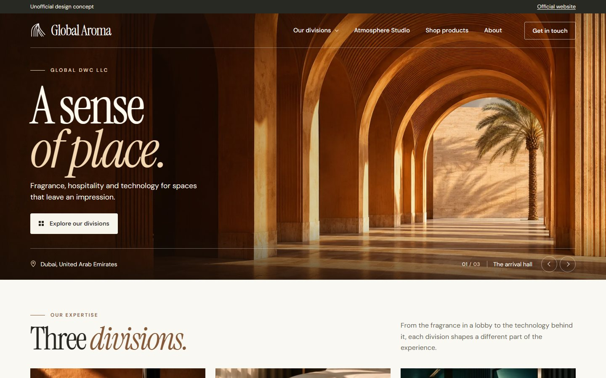

# Global Aroma

A private website and brand concept for Global DWC LLC in Dubai. The seven-page site introduces the Aroma, Hospitality and Technology divisions. Atmosphere Studio lets a visitor turn a choice of space and fragrance into a brief for the company. The handoff includes the editable social campaign and the two-page owner presentation.

[Owner presentation](output/pdf/Global-Aroma-Owner-Presentation.pdf) · [Social campaign](social/README.md) · [Preview access and QA](docs/DEPLOYMENT.md)



## Explore the site

| Page | What a visitor can do |
| --- | --- |
| `/` | Browse three architectural scenes, meet the divisions and open individual fragrance notes. |
| `/divisions/aroma/` | Explore scent marketing, oils and diffusers. The shop section links directly to products and categories in the official store. |
| `/divisions/hospitality/` | Review guest amenities, linen and hospitality supplies, then start a division-specific enquiry. |
| `/divisions/technology/` | Explore ICT, connectivity and digital signage, then discuss a project. |
| `/studio/` | Combine a hotel lobby, restaurant or workplace with one of three scent profiles. Copy the brief or carry it into an enquiry. |
| `/about/` | Learn how the three divisions fit within Global DWC LLC. |
| `/contact/` | Edit a project brief, prepare an email draft or use the published Dubai office contact channels. |

## Run locally

Use Node.js 24.x and npm from the repository root. Local development needs no credentials or environment file.

```sh
npm ci
npm run dev
```

Open the local address printed by Astro. To review the files that would be deployed, run `npm run build` followed by `npm run preview`.

## Architecture

Astro builds static HTML from the page templates and typed content. The three division routes share one template. Native HTML handles navigation and disclosures. Browser scripts add scene selection, Studio state and email drafting. Studio stores the selected space and scent in the URL so the choice survives a reload. A JavaScript-disabled visitor can read the sample brief and open it in their mail app.

| Area | Source of truth |
| --- | --- |
| Routes, shared navigation, metadata and concept notice | [Pages](src/pages/) · [Layout](src/layouts/Layout.astro) |
| Division services, projects and buying links | [Division records](src/data/divisions.ts) · [Division page](src/pages/divisions/%5Bslug%5D.astro) |
| Studio choices, brief text and browser interactions | [Studio data](src/data/studio.ts) · [Studio script](src/scripts/studio.ts) |
| Typography, composition and responsive media | [Styles](src/styles/) · [Image and wordmark components](src/components/) · [Local assets](public/) |
| Social artboards, campaign copy and export tooling | [Social package](social/README.md) |
| Browser verification and local performance measurements | [Test scripts](scripts/) |

## Verify a change

```sh
npm run check
npm run build
npx playwright install chromium webkit
npm test
```

On a fresh Linux runner, use `npx playwright install --with-deps chromium webkit` to install system libraries. The suite starts its own local server against `dist/`. It checks all seven pages at five widths, runs accessibility scans at two widths, and exercises navigation, Studio, enquiry and JavaScript-disabled flows in Chromium and WebKit. For three throttled mobile homepage measurements, run `npm run measure` after building.

[GitHub Actions](.github/workflows/verify.yml) runs the install, check, build and browser suite on pushes and pull requests to `main`. [Local QA](docs/QA.md) and [hosted verification](docs/DEPLOYMENT.md) record the scope and limits of the checks.

## Preview deployment

The owner review runs in the standalone Vercel project `uhbdul/global-aroma-concept`. This repository has no automatic deployment connection. To publish an **authorized update** from a checkout linked to that specific Vercel project, run `vercel deploy --environment=preview --scope uhbdul`. The project uses Astro, Node 24.x, `npm run build` and the `dist/` output. Vercel provides `VERCEL_URL` for absolute social metadata. The PDF, social workspace and QA evidence stay outside the deployed site.

The Production address serves an empty 404. The website lives in a protected Preview with an unofficial-concept notice and indexing exclusions. Share the owner’s revocable reviewer link privately. [Deployment record and access instructions](docs/DEPLOYMENT.md)

## Review and release decisions

- **Research and design.** The research records the public business sources, the original demonstration, design references and reasons for the static implementation. The design guide maps the proposed identity to the shipped assets. [Research and rationale](docs/RESEARCH.md) · [Design system and asset licensing](docs/DESIGN-SYSTEM.md)
- **Orders and enquiries.** Product links use the official WooCommerce store. The contact page prepares an email that the visitor sends. An owner still needs to confirm which requests should be purchases, who receives order notifications, and that a completed checkout reaches that inbox. [Ordering review](docs/ORDERING.md)
- **Materials for approval.** The imagery is illustrative. Commercial use of the proposed identity and visuals, the product selection, office contact details and division routing all need owner review. [Approval register](docs/APPROVALS.md) · [Campaign samples and editable templates](social/README.md)
